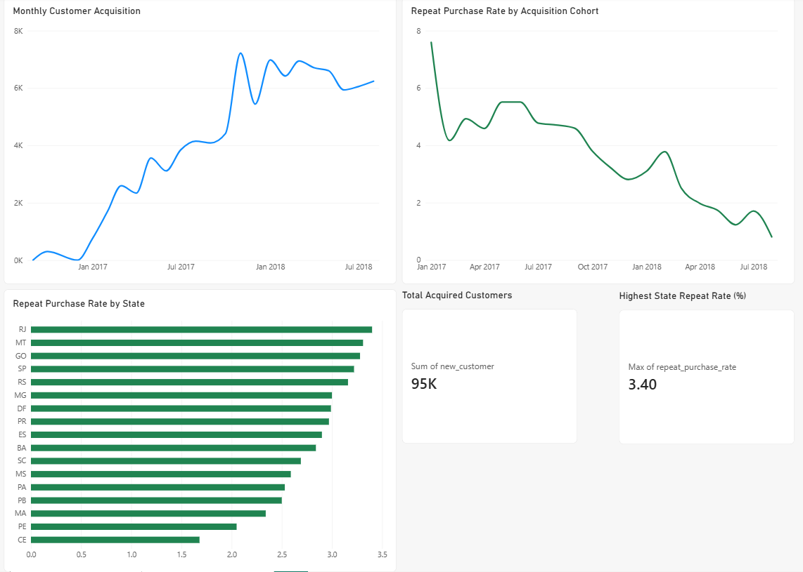
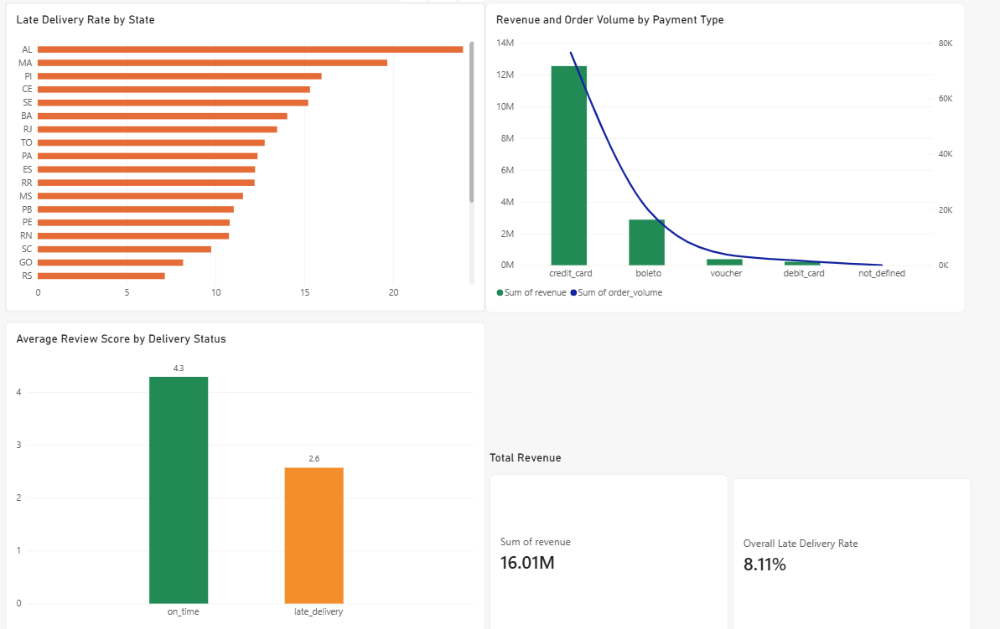

# Olist Customer Retention Analysis

## Executive Summary

This case study analyzes customer acquisition, delivery performance, customer satisfaction, payment behavior, and repeat purchasing in the Olist Brazilian E-Commerce dataset.

A repeat customer is defined as a customer who placed more than one distinct order. The analysis uses `customer_unique_id` because the same customer may receive a different `customer_id` for each order.

Among states with at least 500 customers, Rio de Janeiro had the highest repeat purchase rate at 3.40%. Delivery performance was strongly associated with customer satisfaction: on-time deliveries received an average review score of 4.29, compared with 2.57 for late deliveries. Credit cards generated the highest revenue and order volume.

## Business Question

Which customer segments have higher repeat purchase rates?

## Dataset

**Source:** [Brazilian E-Commerce Public Dataset by Olist on Kaggle](https://www.kaggle.com/olistbr/brazilian-ecommerce/home).

The analysis uses the following PostgreSQL tables:

- `analytics.fact_order_items`
- `analytics.dim_date`
- `analytics.dim_customer`
- `olist.orders`
- `olist.customers`
- `olist.order_reviews`
- `olist.order_payments`

## Customer and Metric Definitions

### Customer Identifier

`customer_unique_id` is used to identify an individual customer across multiple orders.

### Repeat Customer

A repeat customer is a customer who placed more than one distinct order.

### Repeat Purchase Rate

```text
Repeat purchase rate =
repeat customers / total customers × 100
```

States with fewer than 500 customers were excluded from the final ranking to reduce the effect of small samples.

## Key Insights

1. **Rio de Janeiro led repeat purchasing:** RJ had the highest qualified repeat purchase rate at 3.40%, followed by MT at 3.31% and GO at 3.28%.
2. **Repeat purchasing was generally low:** Even the leading qualified state had a repeat purchase rate of only 3.40%.
3. **São Paulo had the largest repeat-customer volume:** SP had 1,296 repeat customers and a repeat purchase rate of 3.22%.
4. **Late delivery was associated with lower satisfaction:** The average review score was 4.29 for on-time deliveries and 2.57 for late deliveries.
5. **Credit cards dominated payments:** Credit cards generated approximately 12.54 million in revenue from 76,505 distinct orders.
6. **Sample size changed the ranking:** AC had a 5.19% repeat rate, but this represented only 4 repeat customers among 77 customers, so it was excluded from the final comparison.

## Recommendations

1. Prioritize retention campaigns in São Paulo and Rio de Janeiro.
2. Investigate the sellers, carriers, categories, and regions associated with late deliveries.
3. Test personalized post-purchase offers for credit-card customers.

## Additional Data Needs

1. Marketing channel, campaign exposure, promotion usage, and acquisition-cost data.
2. Carrier events, delivery attempts, support tickets, refunds, and complaint data.

## Data Quality

Validation found no missing customer identifiers, duplicate order IDs, invalid repeat-customer counts, or mismatches between first-order records and distinct customers. Eight delivered orders had missing delivery dates and were excluded from delivery comparisons.

## Dashboard

### Customer Retention



### Delivery & Payments



## Limitations

The dataset covers a limited observation period and does not include detailed marketing or customer-service information. The results show associations and should not automatically be interpreted as causal.
